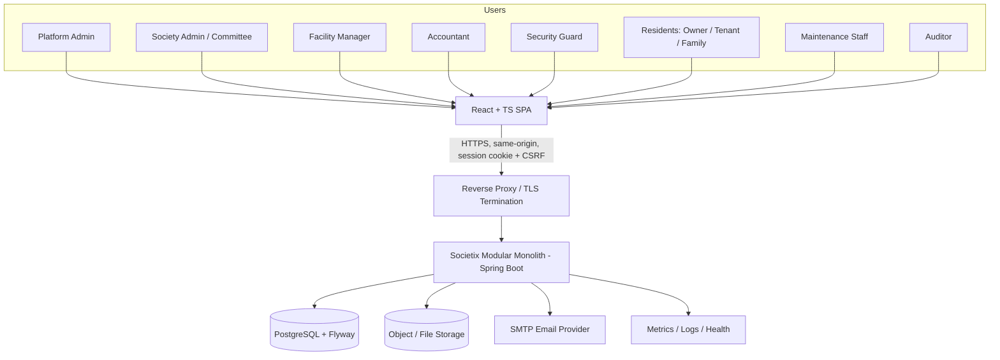
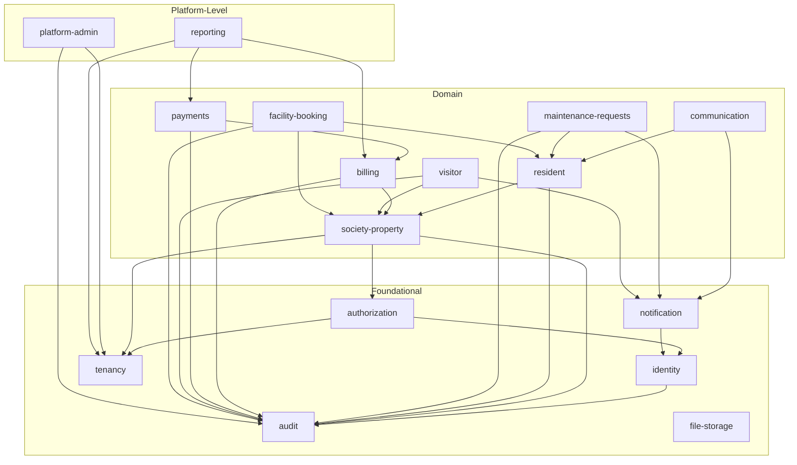
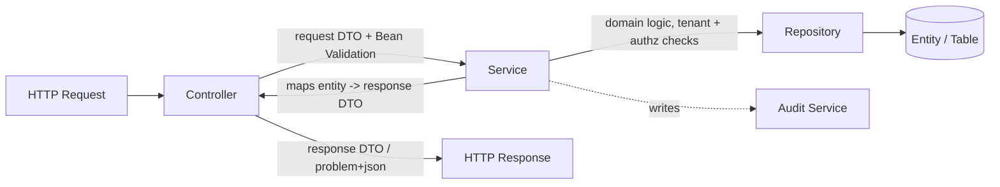
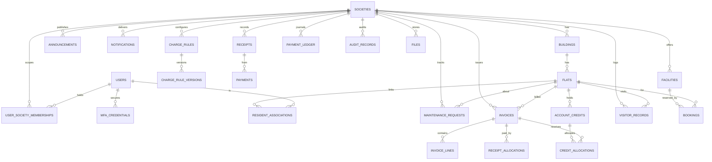
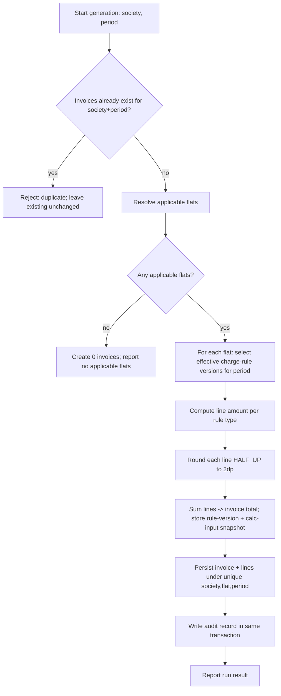

# Design Document

## Overview

Societix is a multi-tenant housing-society management SaaS built as a **modular monolith**: a single deployable Spring Boot application composed of clearly bounded in-process modules, backed by a shared PostgreSQL database with Flyway-managed migrations, and served to a React + TypeScript single-page application (SPA). This design deliberately avoids microservices: the operational surface is small, the domains are tightly coupled around a single tenant boundary (the Society), and transactional integrity across modules (notably "state change persisted iff audit record persisted", Requirement 16) is far simpler and more reliable inside a single transactional boundary than across a distributed system.

The design is organized around three non-negotiable, foundational concerns that constrain every other module:

1. **Tenant isolation (Requirement 1, Goal G1):** Every tenant-owned row carries a non-null `society_id`. Tenant scope is resolved **server-side** from the authenticated session and enforced centrally in the data-access layer, with PostgreSQL Row-Level Security (RLS) as a defense-in-depth backstop.
2. **Server-side authorization (Requirements 3, 17):** Every protected operation is authorized on the server against the role/permission model derived from the Permission Matrix, with both function-level and object-level (BOLA/IDOR) checks.
3. **Monetary correctness and auditability (Requirements 8, 9, 16, 22, Goals G2, G4):** All money is `BigDecimal` at two-decimal (paisa) precision with `HALF_UP` rounding; all financial, security, and administrative state changes write an immutable audit record atomically within the same database transaction.

This document specifies the system architecture and module boundaries, the backend and frontend structure, the tenant-isolation and auth strategies, the PostgreSQL schema, the financial/charge-engine model, API and error contracts, email integration, audit/observability, retention/privacy capabilities, file storage, background processing, the testing strategy and quality gates, the Docker/CI/CD/backup approach, and a set of executable correctness properties. Requirement references appear throughout in the form `(Req N.M)`.

### Technology Stack

Exact versions are **pinned during the M1 bootstrap milestone**; the recommended current-stable baseline is:

| Layer | Choice | Notes |
|---|---|---|
| Language (backend) | Java 21 LTS | Records, pattern matching, virtual threads available |
| Framework | Spring Boot 3.x (latest stable) | Spring Web, Security, Data JPA, Validation, Mail, Actuator |
| Build | Maven | Reproducible builds, dependency locking |
| Persistence | PostgreSQL 16+, Hibernate/JPA, Flyway | `hbm2ddl` disabled in all non-test profiles |
| Testing (backend) | JUnit 5, Mockito, Testcontainers, AssertJ, jqwik (property-based) | Real Postgres in integration tests |
| API docs | springdoc-openapi | OpenAPI 3 at `/api/v1`, Swagger UI gated by role/profile |
| Language (frontend) | TypeScript (strict) | `strict: true`, `noUncheckedIndexedAccess` |
| Frontend framework | React + Vite | Fast dev server, ES build |
| Routing / server state | React Router, TanStack Query | Query cache keyed by tenant + resource |
| Forms / validation | React Hook Form + Zod | Zod schema is the single source of client validation truth |
| Styling | Tailwind CSS + design tokens | Themeable; light theme first |
| Testing (frontend) | Vitest, React Testing Library, Playwright, axe | Unit, component, E2E, accessibility |

### Design Goals Traceability

| Goal | Design mechanism |
|---|---|
| G1 — tenant isolation | `society_id` on every tenant table, central repository scoping, RLS backstop, tenant-isolation test suite |
| G2 — billing correctness | `BigDecimal` paisa precision, HALF_UP, invoice total reconciliation, rule-version snapshot |
| G3 — collection visibility | Collection-status read models per flat (invoiced/paid/outstanding) |
| G4 — audit completeness | Transactional audit write, append-only, DB-enforced immutability |
| G5 — accessibility | WCAG 2.2 AA component library, axe automated checks, documented manual review |
| G6 — availability/performance | Stateless app tier, tenant-first indexes, async bulk jobs, Actuator/Micrometer |

## Architecture

### System Context



External dependencies are deliberately minimal (Req A3, A4, A5): PostgreSQL, a file/object store, and an SMTP provider. No payment gateway and no SMS/WhatsApp channel are integrated in the MVP (Req 9.4, 15.4, BR7).

### Module Architecture (Modular Monolith)

The application is partitioned into bounded modules. Each module owns its entities, repositories, services, and controllers, and exposes a narrow **in-process service interface** to other modules. Cross-module calls go through these interfaces only (never by reaching into another module's repositories or entities), which keeps dependencies acyclic and makes a future extraction to separate services feasible if ever needed.



#### Module Responsibilities and Allowed Dependencies

| Module | Responsibility | May depend on |
|---|---|---|
| `tenancy` | Society entity, tenant provisioning/suspension, `TenantContext` holder, tenant-scope enforcement primitives | (foundation — no domain deps) |
| `identity` | User accounts, credentials, password hashing, sessions, MFA credentials, email verification | `audit` |
| `authorization` | Role/permission model, Permission Matrix enforcement, method + object-level checks | `identity`, `tenancy` |
| `audit` | Append-only audit records written transactionally | (foundation) |
| `notification` | In-app notifications; external channel abstraction (email) | `identity` |
| `file-storage` | File metadata, brokered time-limited URLs, upload validation | `tenancy`, `authorization` |
| `society-property` | Societies' buildings, wings, flats | `tenancy`, `authorization`, `audit` |
| `resident` | Owner/tenant/family associations with history | `society-property`, `audit` |
| `communication` | Announcements and targeting | `resident`, `notification` |
| `maintenance-requests` | Request lifecycle and assignment | `resident`, `notification`, `audit` |
| `billing` | Charge rules (versioned), invoice generation | `society-property`, `audit` |
| `payments` | Receipts, credits, allocations, refunds, ledger | `billing`, `audit` |
| `visitor` | Visitor entries/exits, approval coordination | `society-property`, `resident`, `notification`, `audit` |
| `facility-booking` | Facilities, bookings, approval, conflict prevention | `society-property`, `resident`, `audit` |
| `platform-admin` | Society onboarding/suspension, audited drill-down, platform metrics | `tenancy`, `audit` |
| `reporting` | Financial/operational reports (tenant-scoped, read-only) | `billing`, `payments`, `tenancy` |

**Enforcement of boundaries:** package-by-module layout (`com.societix.<module>`) with ArchUnit tests asserting (a) no cross-module access to `*.internal` packages, (b) no cycles between modules, and (c) controllers/entities never cross module boundaries. Each module exposes a public `api` package (service interfaces + DTOs) and keeps entities/repositories in an `internal` package.

### Repository Layout

```
smart-apartment-management/
├── backend/                     # Maven project (Spring Boot)
│   ├── pom.xml
│   └── src/
│       ├── main/java/com/societix/
│       │   ├── tenancy/ identity/ authorization/ audit/ notification/
│       │   ├── filestorage/ societyproperty/ resident/ communication/
│       │   ├── maintenance/ billing/ payments/ visitor/ facilitybooking/
│       │   ├── platformadmin/ reporting/
│       │   └── common/          # error envelope, base DTO, pagination, config
│       ├── main/resources/
│       │   ├── application.yml  # profiles: local, test, prod
│       │   └── db/migration/    # Flyway V__*.sql
│       └── test/java/com/societix/...   # unit, integration (Testcontainers), arch
├── frontend/                    # Vite + React + TS
│   ├── package.json  vite.config.ts  tsconfig.json
│   └── src/ (features/ components/ lib/ hooks/ routes/ styles/)
├── infra/                       # reverse proxy, deployment, RLS notes
├── docs/                        # ADRs, runbooks, API notes
├── scripts/                     # dev/ci helper scripts
├── docker-compose.yml           # postgres, app, frontend, mailhog
├── .env.example
├── .gitignore
└── README.md
```

### Backend Layered Architecture (per module)

Each module follows a strict layering: **controller (REST) → service → repository (Spring Data JPA) → entity**.



Rules:
- **DTOs at the boundary.** Controllers accept and return DTOs only; JPA entities are never serialized as API contracts. A mapping layer (hand-written mappers or MapStruct, decided in M1) converts entity ↔ DTO.
- **Bean Validation** (`jakarta.validation`) annotations on request DTOs; validation runs before any state change (Req 17.2, 17.3).
- **Global exception handler** (`@RestControllerAdvice`) produces a consistent RFC 7807 `application/problem+json` envelope. Stack traces and internal identifiers are never leaked (Req 17.10).
- **Transactions** are opened at the service layer. The audit write participates in the same transaction (Req 16.1–16.3, 16.6).

### Frontend Architecture

A Vite + React + TypeScript (strict) SPA, same-origin with the backend so it can use the server-side session cookie with CSRF protection.

```
frontend/src/
├── routes/            # route definitions, role-guarded routes
├── features/          # one folder per domain feature (billing, residents, visitors, ...)
│   └── billing/ (api.ts, components/, hooks/, schemas.ts, types.ts)
├── components/        # reusable accessible UI library (primitives + patterns)
├── hooks/             # cross-cutting hooks (useAuth, useTenant, usePermissions)
├── lib/               # api client, query client, csrf, formatting (INR, IST), zod helpers
├── styles/            # tailwind config, design tokens
└── app/               # application shell, providers, error boundaries
```

- **Server state** via TanStack Query; query keys are prefixed with the resource and rely on the server session for tenant scope (the client never sends a society id to scope data — Req 1.2, BR1).
- **Forms** via React Hook Form with Zod resolvers; the Zod schema mirrors backend validation so the user gets immediate, accessible feedback, but the server remains authoritative.
- **Role-aware application shell:** navigation and actions render based on the permissions returned by the server for the current session. Hiding a control is a UX affordance only — the server enforces authorization regardless (Req 17.1).
- **Accessible component library** (WCAG 2.2 AA, Req 19): navigation, data tables (sortable/filterable, keyboard operable), dialogs (focus-trapped, escape-closable), forms (programmatic labels + error association, Req 19.4), metric cards, filter bars, alerts, toasts (ARIA live regions, Req 19.6), and empty/skeleton/error states. All interactive controls are keyboard reachable with a visible focus indicator (Req 19.2, 19.3) and respect `prefers-reduced-motion`.

#### Premium Visual Direction

A restrained, trustworthy aesthetic suited to a finance-adjacent product. Anchored on a **deep navy/charcoal** foundation for headers, primary surfaces, and navigation; **restrained teal/emerald accents** reserved for primary actions, selection, and positive financial states; **neutral surfaces** (warm grays/off-white) for content areas to keep dense tables readable. Delivered as design tokens (color, spacing, radius, elevation, typography scale) so theming is centralized. **Light theme first**, with contrast ratios meeting WCAG 2.2 AA (≥4.5:1 text, ≥3:1 UI/graphical). Motion is subtle and disabled under reduced-motion preferences.

## Components and Interfaces

This section describes the key in-process service interfaces (the module `api` packages). Signatures are illustrative; exact types are finalized during implementation.

### TenantContext and Tenant Scoping (tenancy)

```java
// Request-scoped holder; populated by a servlet filter after authentication.
interface TenantContext {
    UUID currentSocietyId();        // throws if unresolved for tenant-owned ops
    boolean isPlatformAdmin();      // platform scope, cross-tenant only via audited ops
    boolean isResolved();
}

// Enforcement primitive used by base repositories and the RLS GUC setter.
interface TenantScope {
    void applyToSession(Connection c);   // SET app.current_society = :id
    void clearOnReturn(Connection c);    // RESET app.current_society
}
```

### Authentication and Authorization

```java
interface AuthenticationService {
    SessionResult authenticate(String identifier, String password, MfaInput mfa);
    void signOut(SessionId id);
    ResetToken requestPasswordReset(String email);
    void completePasswordReset(ResetToken t, String newPassword);
    void requireStepUp(SessionId id, MfaInput mfa);   // reauthentication for sensitive ops
}

interface AuthorizationService {
    void checkPermission(Actor actor, Permission permission, TargetScope scope);
    boolean canAccessObject(Actor actor, TenantOwned object);  // object-level / BOLA
}

interface MfaService {
    MfaEnrollment beginEnrollment(UserId user);         // TOTP secret + QR
    RecoveryCodes confirmEnrollment(UserId user, String totp);
    boolean verify(UserId user, String totpOrRecovery);
}
```

### Billing and Payments

```java
interface BillingService {
    ChargeRuleVersion configureChargeRule(ChargeRuleInput in);     // versioned, effective-dated
    InvoiceRun generateInvoices(BillingPeriod period, SocietyId society); // idempotent per (society, period)
    CollectionStatus collectionStatus(SocietyId society);          // per-flat invoiced/paid/outstanding
}

interface PaymentService {
    Receipt recordPayment(PaymentInput in);        // rejects duplicate external ref; overpay -> credit
    Allocation allocateCredit(CreditId credit, List<InvoiceTarget> targets);
    Adjustment recordAdjustment(AdjustmentInput in);
    Refund recordRefund(RefundInput in);
}
```

### Audit (audit)

```java
// Called within the originating service transaction. No separate transaction, no async.
interface AuditService {
    void record(AuditEntry entry);   // actor, action, target, before/after, ts(UTC), societyId
}
```

### Notification (notification)

```java
interface NotificationService {
    void createInApp(UserId recipient, SocietyId society, NotificationPayload p);
}

interface EmailSender {            // provider abstraction (Req A4)
    DeliveryResult send(EmailMessage m);   // failure recorded, never claimed if unconfigured
}
interface NotificationChannel { ChannelType type(); DeliveryResult deliver(...); }
```

### File Storage (file-storage)

```java
interface FileStorageService {
    FileMetadata store(SocietyId society, UploadRequest req);   // type allow-list + size check
    BrokeredUrl issueDownloadUrl(FileId id, Actor actor);       // authz + tenant check, TTL <= 900s
}
```

## Data Models

### Conventions (apply to all tables)

- **Primary keys:** UUID (v7 preferred for index locality) unless a natural key is clearly superior.
- **Tenant ownership:** every tenant-owned table has `society_id UUID NOT NULL REFERENCES societies(id)` (Req 1.1). Platform-level tables (`societies`, `users`, platform audit) are the only exceptions and are documented as such.
- **Monetary columns:** stored as `NUMERIC(19,2)` and mapped to Java `BigDecimal`. Rationale below.
- **Timestamps:** `TIMESTAMPTZ` stored in UTC (Req 23.1); `created_at`, `updated_at` on mutable tables.
- **Optimistic locking:** `version BIGINT` (`@Version`) on tables with concurrent updates (invoices, bookings, account credits, maintenance requests).
- **Indexes:** tenant-first composite indexes — e.g. `(society_id, <lookup column>)` — so the planner prunes by tenant first and every query path stays tenant-bounded.
- **Deletion policy:** `RESTRICT` deletes where active associations exist (Req 4.8); history/soft-delete where the requirement preserves history (Req 4.5, 5.5, BR8).

#### Monetary Representation Decision

We store money as **`NUMERIC(19,2)`** mapped to Java **`BigDecimal`** (scale 2), rather than `BIGINT` paisa. Both satisfy Req 22.1–22.2 (no binary floating point) and Goal G2 (≤1 paisa error). `NUMERIC(19,2)` is chosen because: (a) it keeps the domain representation (rupees with two decimals) identical across DB, JPA, and API, avoiding scattered ×100/÷100 conversions that are an error source; (b) Postgres `NUMERIC` arithmetic and `SUM` are exact at scale 2, so invoice-line reconciliation (Req 22.5) holds in the database as well as in Java; (c) `BigDecimal` with explicit `MathContext`/`HALF_UP` is the canonical Java money type (RD5, RD6). The trade-off versus `BIGINT` paisa (marginally smaller storage, integer-only arithmetic) is judged not worth the conversion complexity and reconciliation risk. All rounding uses `RoundingMode.HALF_UP` to scale 2 (Req 22.3).

### Entity-Relationship Diagram (MVP)



### Table-by-Table Design

Notation: PK = primary key, FK = foreign key, UQ = unique constraint, IX = index.

**societies** (platform-level) — `id` PK; `name`; `status` (`active`/`suspended`, Req 13.1, 13.3, BR9); `created_at`/`updated_at`. Suspension flips `status`; data retained.

**buildings** — `id` PK; `society_id` FK NOT NULL; `name` (1–100 chars, Req 4.2); `wing` (optional). UQ `(society_id, name)`. IX `(society_id)`.

**flats** — `id` PK; `society_id` FK NOT NULL; `building_id` FK NOT NULL; `identifier` (1–50 chars, Req 4.3); `area` NUMERIC (nullable, for area-based charges). UQ `(building_id, identifier)` (unique flat id per building, Req 4.4). IX `(society_id, building_id)`. Delete RESTRICT if active resident associations (Req 4.8).

**users** (platform-level identity) — `id` PK; `email` UQ; `email_verified` bool (Req 2.14); `password_hash` (adaptive hash, Req 2.4); `full_name` (RD8); `status` (`active`/`locked`/`disabled`); `failed_attempts`, `lockout_until` (Req 2.7, 2.8); `created_at`/`updated_at`. No Aadhaar/PAN/DOB by default (RD8, Req 18.1).

**user_society_memberships** — `id` PK; `user_id` FK; `society_id` FK NOT NULL; `role` (enum of the 11 roles, Req 3.1); `scope` (e.g., assigned-flat/building for scoped roles); `status`. UQ `(user_id, society_id, role)`. IX `(society_id, role)`. A membership defines a user's role *within one society* (Req 3.6, A2). Platform_Admin has no society membership; its scope is platform-wide and cross-tenant access is audited (Req 1.14, 3.5).

**resident_associations** — `id` PK; `society_id` FK NOT NULL; `flat_id` FK NOT NULL; `user_id` FK; `relation` (`owner`/`tenant`/`family`); `start_at`; `end_at` (null = active); `parent_association_id` (family under owner/tenant). History preserved on end (Req 5.5, BR8). Partial UQ: at most one active `tenant` per flat `WHERE relation='tenant' AND end_at IS NULL` (Req 5.6). IX `(society_id, flat_id, relation)`.

**announcements** — `id` PK; `society_id` FK NOT NULL; `title` (≤200, Req 6.2); `body` (≤5000, Req 6.2); `target_type` (`society`/`building`/`flat`, Req 6.4, 6.5); `target_id` (nullable); `published_at`. IX `(society_id, published_at)`.

**notifications** — `id` PK; `society_id` FK NOT NULL; `recipient_user_id` FK; `type`; `payload` JSONB; `read` bool; `created_at`. IX `(society_id, recipient_user_id, read)`. External-channel delivery status tracked separately (Req 15.5) in `notification_deliveries` (`notification_id`, `channel`, `status`, `attempted_at`).

**maintenance_requests** — `id` PK; `society_id` FK NOT NULL; `flat_id` FK (nullable for common area, Req 7.1); `requested_by_user_id` FK; `description` (≤2000, Req 7.2); `status` (`open`/`assigned`/`in_progress`/`resolved`); `assignee_user_id` FK (nullable); `created_at`; `resolved_at`; `version`. IX `(society_id, status)`.

**charge_rules** — `id` PK; `society_id` FK NOT NULL; `name`; `active` bool. **charge_rule_versions** — `id` PK; `charge_rule_id` FK; `society_id` FK NOT NULL; `computation_type` (`equal_per_unit`/`area_based`/`fixed_per_unit`/`recurring`/`one_time`, Req 8.3, RD5); `amount` NUMERIC(19,2) (>0, whole paisa, Req 8.2); `params` JSONB; `effective_from` date (Req 8.4); `created_at`. Prior versions retained, never overwritten (Req 8.4, BR11). IX `(society_id, charge_rule_id, effective_from)`.

**invoices** — `id` PK; `society_id` FK NOT NULL; `flat_id` FK NOT NULL; `billing_period` (e.g., `2025-04`); `total` NUMERIC(19,2) (≥0, Req 8.10); `status`; `rule_snapshot` JSONB (applied rule version + calculation inputs, Req 8.6, BR11); `created_at`; `version`. UQ `(society_id, flat_id, billing_period)` (no duplicate invoice, Req 8.11, BR2). IX `(society_id, billing_period)`.

**invoice_lines** — `id` PK; `invoice_id` FK; `society_id` FK NOT NULL; `description`; `amount` NUMERIC(19,2) (≥0, Req 8.10); `rule_version_id` FK; `calc_input` JSONB (per-line snapshot). Sum of lines == invoice total (Req 22.5).

**receipts** — `id` PK; `society_id` FK NOT NULL; `flat_id` FK NOT NULL; `external_reference`; `amount` NUMERIC(19,2) (>0, Req 9.2); `recorded_by_user_id`; `recorded_at`. UQ `(society_id, external_reference)` (duplicate prevention, Req 9.9, BR3). IX `(society_id, flat_id)`.

**payments** — `id` PK; `receipt_id` FK; `society_id` FK NOT NULL; `amount` NUMERIC(19,2); `method` (manual only in MVP, Req 9.4). Models the money received for a receipt.

**receipt_allocations** — `id` PK; `receipt_id` FK; `invoice_id` FK; `society_id` FK NOT NULL; `amount` NUMERIC(19,2). How a receipt reduces specific invoice balances (Req 9.1); an invoice balance never goes below zero (Req 9.5, BR4).

**account_credits** — `id` PK; `society_id` FK NOT NULL; `flat_id` FK NOT NULL; `source_receipt_id` FK; `balance` NUMERIC(19,2) (≥0); `version`. Overpayment excess recorded here (Req 9.5, BR4).

**credit_allocations** — `id` PK; `account_credit_id` FK; `invoice_id` FK; `society_id` FK NOT NULL; `amount` NUMERIC(19,2); `allocated_by_user_id`; `allocated_at`. Reduces both credit balance and invoice balance by the same amount (Req 9.6).

**payment_ledger** — `id` PK; `society_id` FK NOT NULL; `flat_id` FK; `entry_type` (`payment`/`credit_created`/`allocation`/`adjustment`/`refund`); `amount` NUMERIC(19,2); `ref_id` (points to source row); `actor_user_id`; `created_at`. Append-only auditable ledger of every money movement (Req 9.7, 9.8, RD2).

**visitor_records** — `id` PK; `society_id` FK NOT NULL; `flat_id` FK (nullable, Req 10.3); `visitor_name` (1–100, Req 10.1); `contact` (≤20, optional); `status` (`inside`/`exited`); `entry_at`; `exit_at` (server-recorded, Req 10.4); `decision` (`approved`/`denied`/null); `decision_at`; `recorded_by_user_id`. IX `(society_id, status)`. Partial handling for exit without open entry (Req 10.5, Edge).

**facilities** — `id` PK; `society_id` FK NOT NULL; `name`; `approval_policy` (`auto`/`staff_approval`, Req 12.1, RD7); `capacity`; `bookable_window` JSONB. IX `(society_id)`.

**bookings** — `id` PK; `society_id` FK NOT NULL; `facility_id` FK; `flat_id` FK; `requested_by_user_id`; `start_at`; `end_at`; `status` (`pending`/`confirmed`/`rejected`/`cancelled`/`no_show`); `created_at`; `version`. Conflict prevention via exclusion/overlap guard (Req 12.7, 12.8, BR5) — see Design Decisions. IX `(society_id, facility_id, start_at)`.

**audit_records** — `id` PK; `society_id` (nullable only for platform-level events, Req 13.5); `actor_user_id`; `action`; `target_type`; `target_id`; `before_summary` JSONB; `after_summary` JSONB; `occurred_at` TIMESTAMPTZ (UTC; displayed IST, Req 16.1). Append-only, no app update/delete path (Req 16.4, BR6). IX `(society_id, occurred_at)`. DB-level immutability note in Design Decisions.

**mfa_credentials** — `id` PK; `user_id` FK; `type` (`totp`); `secret_encrypted` (encrypted at rest, Req 24.6); `recovery_codes_hashed` (hashed, single-use, Req 24.5, 24.6); `enabled` bool; `created_at`. Secrets never exposed to any user (Req 24.6).

**files** — `id` PK; `society_id` FK NOT NULL (tenant-owned, Req 17.6); `owner_module`; `content_type`; `size_bytes`; `storage_key`; `created_by_user_id`; `created_at`. UQ `(society_id, storage_key)`. Access only via brokered, ≤900s URL after authz (Req 1.11, 1.12, 17.6).

**Privacy/DPDP support tables** (Req 18, 25): `consent_records` (`society_id`, `data_principal_user_id`, `purpose`, `lawful_ground`, `granted_at`), `data_principal_requests` (`society_id`, `type` access/correction/erasure, `status`, `handled_by`, `handled_at`), `grievances` (`society_id`, `raised_by`, `details`, `status`), `processor_records` (`society_id` nullable, `vendor`, `purpose`), `breach_records` (`society_id` nullable, `detected_at`, `summary`, `notified_at`). Retention policy config in `retention_policies` (`category`, `retention_days`).

## Design Decisions (ADRs)

Each decision records the context, the chosen option, considered alternatives, trade-offs, and security implications.

### ADR-1: Modular Monolith over Microservices

**Context.** A single tenant boundary (Society), tightly coupled domains, and a hard requirement that financial/security/admin state changes and their audit records commit atomically (Req 16.1–16.3, 16.6).

**Decision.** Build a single deployable Spring Boot application with bounded in-process modules and acyclic dependencies (see Module Architecture).

**Alternatives.** (a) Microservices per domain; (b) separate billing service.

**Trade-offs.** Monolith wins on transactional integrity (audit atomicity is a local DB transaction, not a saga), simpler operations, and lower latency for cross-module calls, at the cost of independent scaling/deployment of modules. Module boundaries + ArchUnit keep extraction possible later.

**Security implications.** A single process centralizes tenant and authorization enforcement, reducing the attack surface of inter-service calls and avoiding distributed-trust complexity.

### ADR-2: Tenant Isolation — Central App-Layer Scoping (primary) + PostgreSQL RLS (defense-in-depth)

**Context.** Req 1 is foundational; Goal G1 is zero cross-tenant exposure across *every* path. Assumption A1 mandates shared schema with `society_id` on every tenant row and directs evaluation of RLS.

**Decision — primary.** Enforce tenancy in the application data-access layer: a request-scoped `TenantContext` populated **only** from the authenticated session (never from client input, Req 1.2–1.4, BR1), plus a **mandatory `society_id` predicate** applied centrally. Concretely, a Hibernate `@Filter` (`societyFilter` with parameter `societyId`) is enabled on every session for all tenant-owned entities, and a base repository/specification enforces the predicate so an unscoped query is impossible to write accidentally. If `TenantContext` is unresolved, tenant-owned operations abort and return zero rows (Req 1.6).

**Decision — defense-in-depth.** Enable PostgreSQL **Row-Level Security** on tenant-owned tables as a second, database-enforced layer. Policies compare `society_id` to a session GUC: `current_setting('app.current_society')::uuid`. The application sets this per transaction via `SET LOCAL app.current_society = :id` at transaction start (so it is scoped to the transaction and auto-cleared on commit/rollback), executed in the same connection that runs the queries. Platform_Admin cross-tenant operations run under a distinct, audited path (a dedicated role/bypass policy) that always writes an audit record first (Req 1.14, 13.5).

**Connection-pooling implications.** With a pooled `DataSource`, a connection is reused across requests. Using `SET LOCAL` inside the transaction guarantees the GUC never leaks to the next borrower, because it is reset at transaction end. As a belt-and-braces measure, a pool "on-return" hook issues `RESET app.current_society`. The app never relies on a connection retaining tenant state between transactions.

**Migration strategy for RLS.** RLS is introduced via Flyway migrations: a migration enables `ALTER TABLE <t> ENABLE ROW LEVEL SECURITY; FORCE ROW LEVEL SECURITY;` and creates `CREATE POLICY tenant_isolation ON <t> USING (society_id = current_setting('app.current_society', true)::uuid)`. The application database role is non-superuser and not `BYPASSRLS`. A dedicated migration-time role owns tables; the runtime role is subject to policies. Rollout is staged: ship app-layer scoping first, then enable RLS table-by-table behind a migration, with tenant-isolation tests gating each step.

**Alternatives.** (a) Schema-per-tenant or database-per-tenant — rejected for MVP: heavier migration/ops burden and connection sprawl for many small societies (A1, A3). (b) App-layer scoping only, no RLS — rejected: a single missed predicate would be a silent cross-tenant leak; RLS makes that failure mode a database-enforced denial instead.

**Security implications.** Two independent layers must both fail to leak data. Client-supplied society identifiers are rejected when they differ from the server context (Req 1.4). Background jobs, exports, reports, and file access all resolve tenant scope the same way (see below), so no path bypasses enforcement.

**How each path resolves/enforces tenant scope:**
- **Background jobs** run per explicit Society scope; the job sets `TenantContext` and the GUC for exactly one society per execution and never reads/writes another's rows (Req 1.10, 10 below).
- **Exports/reports** execute under the requester's `TenantContext`; the same filter + RLS apply, so output contains only in-tenant rows (Req 1.9, 14.1).
- **File access** goes through `FileStorageService.issueDownloadUrl`, which checks authz + tenant match and issues a brokered URL with TTL ≤ 900s (Req 1.11, 1.12).

### ADR-3: Authentication — Spring Security Server-Side Sessions with Secure Cookies + CSRF (over JWT)

**Context.** Req A7/OQ3/OQ9 ask for a documented comparison and one selected approach for a same-origin SPA, plus MFA (Req 24).

**Decision.** Use Spring Security **server-side sessions** with a session cookie that is `Secure`, `HttpOnly`, `SameSite=Lax` (strict where feasible), plus **CSRF protection** (synchronizer token delivered to the SPA and echoed on unsafe methods). This is the chosen approach.

**Alternatives — session vs token.**
| Aspect | Server-side session (chosen) | JWT / bearer token |
|---|---|---|
| Revocation | Immediate (invalidate server session; Req 2.15) | Hard — needs denylist/short TTL + refresh |
| XSS exposure | Cookie is `HttpOnly`, not readable by JS | Token often in JS-accessible storage — higher XSS risk |
| CSRF | Needs CSRF tokens (handled) | Not CSRF-prone if in header, but then XSS-prone |
| Idle/absolute expiry (Req 2.10–2.12) | Natural server-side control | Requires custom claims + refresh plumbing |
| Role change mid-session (Edge) | Re-evaluated server-side next request | Stale claims until token refresh |
| Horizontal scale | Needs shared session store if multi-node | Stateless |

**Rationale.** For a same-origin SPA handling financial data, immediate revocation, precise session-lifetime control, and keeping credentials out of JS reach (HttpOnly) outweigh JWT's statelessness. CSRF is a well-understood, bounded cost.

**Session store.** Default to the application/DB-backed session store for a single-node deployment. **Redis is introduced only if horizontal scaling / shared session state is required**; it is documented as the scaling option, not a baseline dependency.

**Session policy (RD3).** Idle timeout 30 min (Platform_Admin, Society_Admin, Accountant, Facility_Manager) / 60 min (Owner, Tenant_Resident, Family_Member); absolute max lifetime 12 h (Req 2.10–2.12). Lockout after 5 failed attempts / 15 min, initial 15-min lockout, progressive delays, never permanent (Req 2.7, 2.8). Password reset and email verification via single-use, time-limited email credentials (Req 2.5, 2.14). Step-up reauthentication (including MFA factor where enabled) for sensitive operations (Req 2.13, 24.8).

**MFA (Req 24).** TOTP authenticator as the initial factor (Req 24.4). Enrollment verifies the factor and issues single-use recovery codes (Req 24.5). TOTP secrets are **encrypted at rest** and recovery codes stored **hashed**; neither is ever exposed to any user (Req 24.6). MFA is **enforced** for Platform_Admin and privileged finance/society-admin roles, **optional** for residents (Req 24.1–24.3). A privileged sign-in that has not completed the MFA challenge is rejected (Req 24.9). All MFA events are audited (Req 24.7).

**Security implications.** HttpOnly cookie mitigates token theft via XSS; CSRF token mitigates cross-site writes; server-side revocation bounds the blast radius of a compromised session.

### ADR-4: Authorization — Role + Permission Model Mapping the Permission Matrix

**Decision.** Model the 11 roles (Req 3.1) and a set of `Permission` values (operation × resource type). The **Permission Matrix is encoded as the authoritative mapping** (a data table loaded at startup and exercised by tests). Two enforcement layers:
- **Function-level:** method security (`@PreAuthorize`/a custom `PermissionEvaluator`) checks the actor's role/permission and scope (P/S/F/A) for the operation before execution (Req 3.2, 17.1). Denied operations cause no partial state change (Req 3.3).
- **Object-level (BOLA/IDOR):** every by-id access verifies the object's `society_id` matches `TenantContext` and, for flat-scoped roles, that the actor is associated with the object's flat; cross-tenant/unowned access returns the not-found response (Req 1.7). This closes the gap that function-level checks alone leave open.

Role changes are re-evaluated on the next protected operation, not cached (Edge).

### ADR-5: Booking Concurrency — DB-Level Overlap Guard

**Context.** Req 12.7–12.8 / BR5: at most one confirmed booking per facility and overlapping window, even under concurrent requests.

**Decision.** Prevent overlaps at the database using a PostgreSQL **exclusion constraint** on `bookings` over `facility_id` equal and a `tstzrange(start_at, end_at)` overlap, scoped to confirmed/pending-hold states (`EXCLUDE USING gist (facility_id WITH =, tstzrange(start_at,end_at) WITH &&) WHERE (status IN ('confirmed','pending'))`). Combined with `@Version` optimistic locking on `bookings`, concurrent requests resolve to exactly one winner; losers receive a conflict error (Req 12.8).

**Alternatives.** Application-level check-then-insert (race-prone), or pessimistic row locks on the facility (serializes all bookings, worse throughput). The exclusion constraint is both correct under concurrency and non-blocking for non-overlapping windows.

### ADR-6: Audit Immutability — Transactional Write + DB-Enforced Append-Only

**Decision.** `AuditService.record` is called **inside the originating service transaction** (no async, no separate connection), so the state change and audit record commit or roll back together (Req 16.1–16.3, 16.6). Immutability (Req 16.4, BR6) is enforced by: (a) no update/delete code path on `audit_records` anywhere in the application; and (b) a database safeguard — the runtime role is `REVOKE`d `UPDATE, DELETE` on `audit_records`, with a `BEFORE UPDATE OR DELETE` trigger raising an exception as a backstop. Audit records are never replaced by application log lines (Req 21.5).

## Financial Data Model and Charge Engine

### Monetary Arithmetic (Req 22, RD6)

All money is `BigDecimal`. Computation uses a documented intermediate precision and a single rounding boundary:

- **Intermediate precision.** Divisions and area/ratio computations use `MathContext(34, HALF_UP)` (DECIMAL128) so intermediate values do not lose significance before the final rounding.
- **Rounding boundary.** Rounding to scale 2 with `RoundingMode.HALF_UP` is applied **once per invoice line** (the final monetary output), not repeatedly mid-calculation. Each line is rounded, then lines are summed to form the invoice total (Req 22.3, 22.4).
- **Reconciliation.** Because the total is the exact sum of already-rounded lines, `sum(lines) == total` holds exactly at scale 2 (Req 22.5). Both are `≥ 0` (Req 8.10).
- **Display.** Amounts are formatted in INR with two decimals (Req 22.6); display time zone IST (Req 23.2).

### Charge-Engine Computation Flow

For a billing run over a society and period:



**Per rule type (Req 8.3, RD5):**
- `equal_per_unit`: total society charge divided equally across applicable flats (division uses DECIMAL128 intermediate, then round per line; any residual paisa handled by a documented deterministic distribution so the society total reconciles).
- `area_based`: `rate × flat.area`.
- `fixed_per_unit`: a fixed amount per flat.
- `recurring`: a fixed amount applied each period while the rule is effective.
- `one_time`: a single charge in the period the rule becomes effective.
- Authorized **discounts/adjustments** are applied to the computed charge as explicit, audited lines (never silent).

**Versioning and snapshots (Req 8.4, 8.6, 8.7, BR11, BR12).** Charge rules are versioned with `effective_from`. A billing run selects the version in effect for the period. The invoice stores a `rule_snapshot` (version id + calculation inputs) per line. A later rule change applies only to invoices generated on/after its effective date; previously issued invoices are never recalculated.

**Idempotency / duplicate prevention (Req 8.11, BR2).** The unique constraint `(society_id, flat_id, billing_period)` plus a guard at run start makes generation idempotent: a re-run (including a concurrent one) creates no duplicates and reports already-exists.

### Payment, Credit, and Ledger Flow (Req 9, RD2)

- **Record payment (Req 9.1, 9.2, 9.9):** validate amount `> 0` and whole-paisa; reject duplicate `(society, external_reference)` (BR3). Create receipt + payment; allocate to target invoices, reducing each balance but never below zero (Req 9.5).
- **Overpayment (Req 9.5, BR4):** any excess over targeted outstanding becomes an unallocated `account_credit` for the flat; money is conserved: `sum(receipt_allocations) + credit_created == payment_amount`.
- **Credit allocation (Req 9.6):** reduces credit balance and invoice balances by the same amount; no invoice below zero.
- **Adjustments/refunds (Req 9.8):** recorded explicitly in `payment_ledger`; overpayments are never silently discarded and issued invoices are never rewritten.
- **Ledger (Req 9.7):** every payment, credit creation, allocation, adjustment, and refund is an append-only `payment_ledger` entry; each financial event writes an audit record in the same transaction (Req 9.10, 16.1).

## API Contracts and Error Formats

### REST Conventions

- **Base path & versioning:** `/api/v1`. Breaking changes introduce `/api/v2`; additive changes stay in v1.
- **Resource naming:** plural nouns, hierarchical where natural — e.g. `/api/v1/buildings/{buildingId}/flats`, `/api/v1/invoices`, `/api/v1/facilities/{id}/bookings`. No society id in the path or query for tenant scoping (server-derived, Req 1.2, BR1).
- **Methods/status codes:** `GET` 200; `POST` 201 (+`Location`); `PUT`/`PATCH` 200; `DELETE` 204; validation 400; auth 401; forbidden 403; not-found 404 (also the cross-tenant response, Req 1.7); conflict 409 (duplicate invoice/booking overlap/duplicate payment ref); rate limit 429 (Req 17.4).
- **Pagination/filtering/sorting:** cursor or page/size params (`?page=&size=&sort=field,asc&filter...`); responses carry page metadata. All lists are tenant-scoped (Req 1.8, BR10).
- **DTO patterns:** request DTOs with Bean Validation; response DTOs are explicit view models; entities never serialized.
- **OpenAPI:** springdoc generates OpenAPI 3; Swagger UI exposed only in non-prod or behind Platform_Admin.

### Error Envelope (RFC 7807 problem+json)

A single, documented shape for all errors; no stack traces or internal identifiers (Req 17.10).

```json
{
  "type": "https://societix.app/errors/validation",
  "title": "Validation failed",
  "status": 400,
  "detail": "One or more fields are invalid.",
  "instance": "/api/v1/invoices",
  "correlationId": "b3f1c2a4-...",
  "errors": [
    { "field": "amount", "code": "must-be-positive", "message": "Amount must be greater than zero" }
  ]
}
```

- Authorization failures return `403`/`404` without revealing resource existence (Req 1.7, 17.10).
- `correlationId` matches the request's log correlation id (Req 21.1).

### Idempotency

- **Invoice generation:** guarded by `(society, flat, period)` uniqueness; the endpoint is safe to retry (Req 8.11).
- **Payment recording:** `external_reference` uniqueness per society plus an optional `Idempotency-Key` header for client retries (Req 9.9).

### Representative Endpoints (illustrative, not exhaustive)

| Module | Example endpoint |
|---|---|
| society-property | `POST /api/v1/buildings`, `POST /api/v1/buildings/{id}/flats` |
| resident | `POST /api/v1/flats/{id}/residents`, `POST /api/v1/flats/{id}/residents/{rid}/end` |
| communication | `POST /api/v1/announcements`, `GET /api/v1/announcements` |
| maintenance | `POST /api/v1/maintenance-requests`, `POST /api/v1/maintenance-requests/{id}/assign` |
| billing | `POST /api/v1/charge-rules`, `POST /api/v1/invoice-runs`, `GET /api/v1/collection-status` |
| payments | `POST /api/v1/receipts`, `POST /api/v1/credits/{id}/allocations` |
| visitor | `POST /api/v1/visitors`, `POST /api/v1/visitors/{id}/exit`, `POST /api/v1/visitors/{id}/decision` |
| facility-booking | `POST /api/v1/facilities`, `POST /api/v1/facilities/{id}/bookings`, `POST /api/v1/bookings/{id}/approve` |
| platform-admin | `POST /api/v1/platform/societies`, `POST /api/v1/platform/societies/{id}/suspend` |
| reporting | `GET /api/v1/reports/financial`, `GET /api/v1/reports/collection` |

## Email Integration (Req A4, 15)

- **Abstraction:** `EmailSender`/`NotificationChannel` interfaces wrap Spring Mail / SMTP; the concrete provider is selected by configuration (env).
- **Flows:** password reset (Req 2.5) and email verification (Req 2.14) use single-use, time-limited credentials delivered by email.
- **Delivery-failure handling:** a failed external send records the delivery as failed in `notification_deliveries` while the in-app notification remains delivered (Req 15.5); the system never claims delivery through an unconfigured channel (Req 15.4, BR7).
- **Secure configuration:** SMTP credentials loaded from env/secret store, never in source control (Req 17.5).
- **SMS/WhatsApp:** explicitly deferred.
- **Local dev:** MailHog captures outbound email in docker-compose.

## Audit Logging and Observability (Req 16, 21)

- **Audit (Req 16):** `audit_records` written atomically with the originating transaction (ADR-6); append-only; immutability DB-enforced. Queries return only the reviewer's tenant records, except Platform_Admin under platform scope (Req 16.5).
- **Structured logging (Req 21.1, 21.4):** JSON logs with a correlation id set per request via an MDC servlet filter, propagated to any downstream call (Req 21.2); `society_id` included where applicable. No secrets or full PII in logs (Req 21.4); audit records are never emitted as log lines in place of the Audit_Service (Req 21.5).
- **Metrics/health (Req 21.3):** Micrometer + Spring Boot Actuator expose request rate, error rate, and latency; `/actuator/health` liveness/readiness and metrics endpoints are secured appropriately.

## Data Retention and Privacy Controls (Req 18, 25, OQ4, OQ10)

- **Category-specific retention (Req 18.4, BR14, RD4 provisional defaults):** audit/security 12 months; visitor records 90 days; notifications 12 months; temporary uploads 30 days; backups 35-day rolling. Configurable per category in `retention_policies`, applied by scheduled retention jobs that remove or anonymize expired data, **subject to financial, audit, and legal-hold preservation** (Req 18.6, 25.5).
- **Data-principal requests (Req 18.5, 25.3):** access/correction/erasure requests recorded in `data_principal_requests`; erasure anonymizes personal data while preserving financial/audit integrity (Req 18.6).
- **DPDP readiness capabilities (Req 25):** privacy notice + processing-purpose recording (`consent_records`, Req 25.1, 25.2), grievance workflow (`grievances`, Req 25.4), breach-response recording (`breach_records`, Req 25.6), processor/vendor records (`processor_records`, Req 25.7), children's-data handling flag (Req 25.8), tenant-termination export + deletion (Req 25.9).
- **Legal status:** this design provides **capabilities, not a compliance claim**. DPDP legal interpretation and applicable tax calculations are **PENDING qualified Indian counsel/reviewer** (RD10, OQ10, Req 22.7, 25 note) and are launch blockers, not resolved here.

## File Storage Strategy (Req 1.9, 1.11–1.12, 17.5–17.7)

- **Location:** files stored **outside the web-executable path** — a local volume in dev, an S3-compatible object store in prod; the backend is **configurable** via env (Req 17.6).
- **Metadata:** every `files` row carries `society_id` (tenant-owned) and content/size/key.
- **Access:** only via authenticated + authorized, tenant-scoped, **time-limited brokered/signed URLs with TTL ≤ 900s** (Req 1.11, 1.12). The backend verifies authz and tenant match before issuing the URL.
- **Upload validation (Req 17.6, 17.7):** content-type allow-list and max-size enforced before storing; out-of-policy uploads rejected with a validation reason and not stored. Virus/type scanning is noted as a hook in the upload pipeline.

## Background Processing and Scheduled Jobs

- **Mechanism:** Spring `@Scheduled` + a managed task executor for retention jobs, notification dispatch, and asynchronous bulk invoice generation.
- **Tenant scope (Req 1.10):** every job resolves an **explicit Society scope** and sets `TenantContext` + the RLS GUC for exactly one society per execution; it never touches another society's rows.
- **Bulk status (Req 20.3, 20.5):** bulk/async operations report status `pending`/`in-progress`/`succeeded`/`failed` and never leave committed data inconsistent on failure.
- **Message queue:** external queue infrastructure is **deferred** unless a concrete need justifies it; the in-process executor suffices for MVP volumes.

## Error Handling

- **Validation (Req 17.2, 17.3):** Bean Validation on request DTOs; failures return the problem+json envelope with field-level `errors` before any state change.
- **Authorization (Req 1.7, 17.10):** 403 for forbidden operations; 404 (indistinguishable from nonexistent) for cross-tenant/unowned object access; no internal details leaked.
- **Conflict:** 409 for duplicate invoice runs, duplicate payment references, and booking overlaps.
- **Rate limiting (Req 17.4):** per-client/account limits return 429.
- **Transactional integrity (Req 3.3, 16.6):** any failure (including a failed audit write) rolls back the whole transaction; no partial state change.
- **Unencrypted transport (Req 17.8, 17.9):** requests over unencrypted transport are rejected at the proxy/app edge.

## Correctness Properties

*A property is a characteristic or behavior that should hold true across all valid executions of a system — essentially, a formal statement about what the system should do. Properties serve as the bridge between human-readable specifications and machine-verifiable correctness guarantees.*

These properties are strong candidates for property-based testing: the charge engine, monetary arithmetic, tenant isolation, booking concurrency, and audit atomicity are all pure-logic or invariant-bearing behaviors that should hold "for all" generated inputs. Infrastructure concerns (latency targets Req 20, WCAG conformance Req 19, DB-level audit immutability Req 16.4) are validated by load/accessibility/integration tests instead and are not expressed as properties below.

**Reflection on properties (redundancy elimination).** From the prework, several criteria collapse into single comprehensive properties: all tenant-list/search/export/report scoping criteria (Req 1.5, 1.8, 1.9, 14.1) are one tenant-isolation property over all read paths; invoice-line reconciliation and non-negative balances (Req 8.9, 8.10, 22.5) are one monetary-structure property; overpayment-to-credit and credit allocation (Req 9.5, 9.6) are unified as one money-conservation property because allocation is the same conservation law applied to credits. Duplicate-prevention for invoices (Req 8.11) and payments (Req 9.9) are kept distinct because they guard different keys. The result is the minimal, non-overlapping set below.

### Property 1: Tenant-isolation invariant (no query returns cross-society rows)

*For all* multi-society datasets and *for all* read operations (get-by-id, list, search, export, report, background-job read) executed under a resolved `TenantContext` for some society S, every returned tenant-owned record has `society_id == S`, and a by-id request for a record owned by a society other than S returns the not-found response indistinguishable from a request for a nonexistent id.

**Validates: Requirements 1.5, 1.7, 1.8, 1.9, 14.1**

### Property 2: Tenant-context requirement for tenant-owned operations

*For all* requests against tenant-owned data for which no `TenantContext` can be resolved, the operation is aborted with an error and returns zero tenant-owned records; and *for all* requests supplying a society identifier that differs from the server-derived context, the supplied identifier is rejected and never used to scope access.

**Validates: Requirements 1.3, 1.4, 1.6**

### Property 3: Monetary structure and reconciliation

*For all* generated invoices across all charge-rule computation types, the sum of invoice-line amounts equals the invoice total exactly at two-decimal (paisa) precision, every line amount is ≥ 0, the total is ≥ 0, and all amounts have scale 2 with no rounding error greater than one paisa per line.

**Validates: Requirements 8.9, 8.10, 22.3, 22.5**

### Property 4: No silent historical recalculation

*For all* sequences of charge-rule versions and previously generated invoices, introducing a new rule version with a later effective date leaves every previously issued invoice's stored total and rule/calculation snapshot unchanged.

**Validates: Requirements 8.7**

### Property 5: Invoice generation idempotency / no duplicates

*For all* societies, flats, and billing periods, generating invoices for a period that already has invoices (including under concurrent generation) creates no duplicate invoice, leaves existing invoices unchanged, and reports that invoices already exist; at most one invoice exists per (society, flat, period).

**Validates: Requirements 8.11**

### Property 6: Money conservation across payments, credits, and allocations

*For all* payments applied to a set of target invoices, the amount applied to invoices plus the account credit created equals the payment amount, and no invoice balance is ever reduced below zero; likewise, *for all* credit allocations, the credit balance and the targeted invoice balances each decrease by the same allocated amount, never driving an invoice below zero.

**Validates: Requirements 9.5, 9.6**

### Property 7: Duplicate payment-reference rejection

*For all* payments whose external reference already exists within the same society, the duplicate is rejected, no second receipt is created, and existing receipts and invoice balances are unchanged.

**Validates: Requirements 9.9**

### Property 8: Booking non-overlap invariant

*For all* sets of booking requests for a facility (including requests submitted concurrently), after processing, no two confirmed bookings for that facility have overlapping time windows, and each rejected conflicting request leaves no overlapping confirmed booking.

**Validates: Requirements 12.7, 12.8**

### Property 9: Audit-atomicity invariant

*For all* audited financial, security, and administrative operations, the domain state change is persisted if and only if its audit record is persisted — when the audit write fails the entire operation rolls back and no state change is committed, and when the operation succeeds exactly one corresponding audit record exists.

**Validates: Requirements 16.1, 16.2, 16.3, 16.6**

### Property 10: Permission-matrix enforcement

*For all* (role, operation) pairs, the server authorizes the operation if and only if the Permission Matrix permits that role for that operation within the applicable scope, and any denied operation produces no partial state change.

**Validates: Requirements 3.2, 3.3, 3.8**

### Property 11: Password hashing

*For all* valid passwords, the stored credential is a salted adaptive one-way hash that verifies the original password, never equals the plaintext, and differs between two independent stores of the same password (unique salt).

**Validates: Requirements 2.4**

### Property 12: MFA enforcement for privileged roles

*For all* accounts holding a privileged role (Platform_Admin or a privileged finance/society-admin role under the MFA policy), a sign-in that has not completed the MFA challenge is rejected and no authenticated session is granted.

**Validates: Requirements 24.1, 24.2, 24.9**

### Property 13: Flat-identifier uniqueness within a building

*For all* buildings, attempting to create a flat whose identifier duplicates an existing flat identifier in the same building is rejected and creates no new flat, while the same identifier in a different building is permitted.

**Validates: Requirements 4.4**

### Property 14: At most one active tenant association per flat

*For all* flats, attempting to add a second active Tenant_Resident association while one is active is rejected, and exactly one active tenant association remains.

**Validates: Requirements 5.6**

### Property 15: Announcement notification fan-out

*For all* published announcements and target scopes, exactly one in-application notification is created for each targeted resident and none for non-targeted residents.

**Validates: Requirements 6.1, 6.3**

### Property 16: File URL expiry and authorization

*For all* issued file-download URLs, the URL's time-to-live is at most 900 seconds, access requires a matching authenticated and tenant-authorized requester, and an expired URL is denied.

**Validates: Requirements 1.11, 1.12**

### Property 17: Society provisioning atomicity

*For all* society-provisioning attempts that fail before completion, no active society record remains, and whenever a society is active its initial Society_Admin association exists.

**Validates: Requirements 4.1, 13.1, 13.2**

### Property 18: Category-specific retention

*For all* records whose age exceeds their category's configured retention period, after the retention job runs the record is removed or anonymized unless it is preserved for financial, audit, or legal-hold integrity, in which case it is retained.

**Validates: Requirements 18.4, 25.5**

## Testing Strategy

PBT is appropriate for this feature's pure logic and invariants (charge engine, money conservation, tenant isolation, booking non-overlap, audit atomicity). It is **not** used for latency/availability targets (Req 20), WCAG conformance (Req 19), or DB-level audit immutability (Req 16.4), which use load tests, accessibility tooling, and integration/migration tests respectively.

### Testing Pyramid

- **Unit tests:** services, the charge engine, rounding boundaries, validation — concrete examples and edge cases.
- **Repository/integration tests:** **Testcontainers PostgreSQL** (real DB), exercising constraints, RLS policies, and migrations.
- **REST API tests:** MockMvc/WebTestClient for controllers, DTO validation, and the error envelope shape.
- **Security + authorization tests:** authentication, session policy, MFA, and the full Permission Matrix (Property 10).
- **Tenant-isolation tests (critical, Goal G1):** cross-tenant access attempts across **every** path — APIs, direct object references, search, exports, reports, background jobs, and file access (Properties 1, 2, 16).
- **Financial correctness, duplicate-processing, and concurrency tests:** monetary invariants, duplicate invoice/payment guards, and concurrent booking/invoice/credit races (Properties 3–8).
- **Frontend tests:** Vitest + React Testing Library for components and form validation (Zod); Playwright E2E for key journeys (sign-in + MFA, raise maintenance request, generate invoices, record payment, book facility, visitor entry/exit).
- **Accessibility checks:** axe automated checks in component/E2E tests plus documented manual review (Req 19.1, G5).
- **Migration tests:** Flyway migrations apply cleanly on a fresh DB; RLS enablement verified.

### Property-Based Testing Configuration

- Library: **jqwik** for the Java backend; fast-check for frontend property checks where applicable.
- **Minimum 100 iterations** per property test.
- Each property test is tagged referencing its design property, format: **Feature: societix-platform, Property {number}: {property_text}**.
- Each correctness property (Properties 1–18) is implemented by a **single** property-based test, complemented by example-based unit tests for specific edge cases.
- Expensive external interactions are mocked inside property tests; real-DB behavior is covered by Testcontainers integration tests.

### Quality Gates (must pass before a task is "done")

1. Backend compiles; `hbm2ddl` disabled outside tests.
2. All unit, integration (Testcontainers), API, security, and tenant-isolation tests pass.
3. All property tests (Properties 1–18) pass at ≥100 iterations.
4. Flyway migrations apply cleanly on a fresh database; RLS policies verified.
5. Frontend builds under TS strict; component/form tests pass; axe checks report no violations on touched screens.
6. Lint/format (backend + frontend) and dependency vulnerability scan pass.
7. No secrets committed; no PII/secrets in logs.

### Property-Based Testing Candidates (highlighted)

Monetary invariants (Property 3, 6), overpayment/credit invariants (Property 6), booking non-overlap (Property 8), tenant-isolation (Property 1), and audit-atomicity (Property 9) are the highest-value property candidates and should be implemented first.

## Docker-Based Development, CI/CD, Deployment, Backup/Recovery (Req A3)

### Local Development

`docker-compose.yml` brings up: **postgres**, the **app** (backend), the **frontend** (Vite dev server), and **mailhog** (captures outbound email). Configuration is environment-based; `.env.example` documents every variable (DB URL/credentials, SMTP, file-storage target, session/cookie settings, MFA encryption key). Secrets are never committed (Req 17.5).

### CI (GitHub Actions)

Pipeline stages: format check → lint → **backend build + test** (unit + Testcontainers integration + property tests) → **frontend build + test** (Vitest + Playwright smoke + axe) → **dependency vulnerability scan**. The pipeline fails on any quality-gate violation.

### Deployment Architecture

Single Indian-region deployment (A3) behind a **reverse proxy terminating TLS** (Req 17.8, 17.9). The Spring Boot app runs stateless (session store DB-backed, or Redis if horizontally scaled — ADR-3); PostgreSQL is the managed datastore; files go to the configured object store in prod.

### Database Migrations

Schema changes ship exclusively as **Flyway** versioned migrations (`V__*.sql`); `hbm2ddl` is never enabled in non-test profiles. RLS policies are introduced and evolved through migrations (ADR-2). Migrations are validated in CI against a fresh Testcontainers database.

### Backup and Recovery

Encrypted database backups on a **35-day rolling retention** (RD4). A documented restore procedure targets defined recovery objectives (RPO/RTO set during M1/M7 and recorded in runbooks). Backups and restores are tested periodically; file-store contents are backed up alongside the database.

### Rollback / Release and Secrets

Releases are versioned and roll forward by default; a documented rollback procedure covers application rollback and, where a migration must be reversed, a compensating forward migration (Flyway does not auto-undo in prod). Secrets are loaded from env/secret store at runtime (Req 17.5), never from source control, including the MFA secret-encryption key and SMTP/DB credentials.
